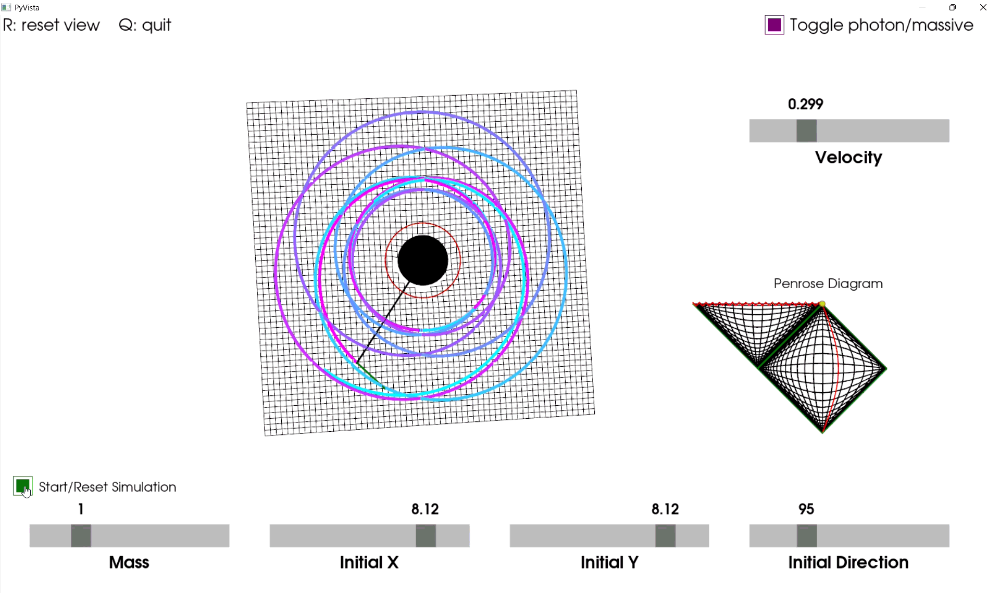
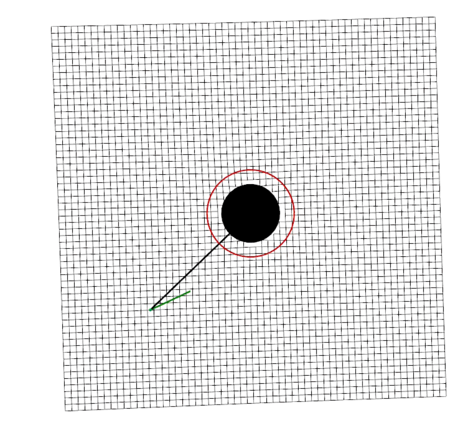
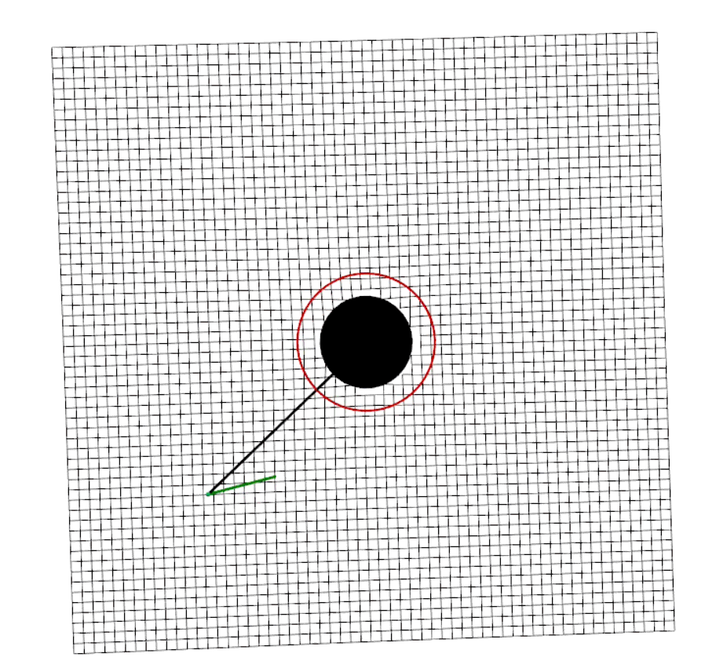
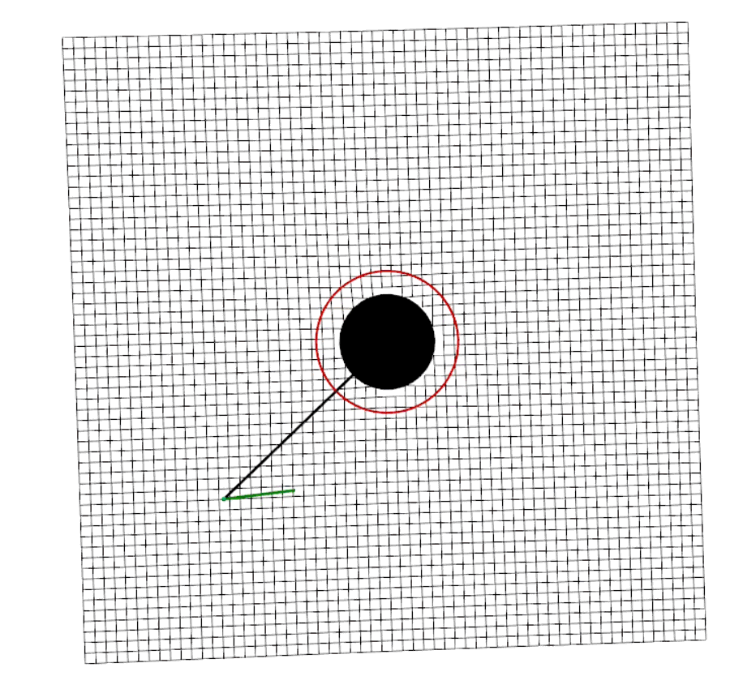

# Interactive Schwarzschild geodesics



An interactive simulation of how light and massive particles move around a non-spinning (Schwarzschild) black hole. Launch a photon or a particle and watch its path in space alongside its trajectory on a **Penrose diagram** representing the black hole's spacetime.

## Running the program

```bash
pip install -r ../requirements.txt
python schwarzschild_geodesics.py
```

No GPU required for the simulation. As part of requirements, make sure to install the package `colour-science` and not `colour` (which is a different package with the same import name).

| Control | What it does |
|---|---|
| Mass slider | Changes the black hole's mass (Scales the horizon, photon sphere and surface) |
| Initial X / Initial Y | Launch position of the particle |
| Initial Direction | Launch angle in degrees, measured relative to the outward radial direction |
| Velocity | Launch speed as a fraction of light speed (only for massive particles) |
| Green button | Start / stop the simulation |
| Top-right toggle | Switch between a massless photon (green) and a massive particle (purple) |
| R / Q | Reset the view / quit |

Sliders are locked while the simulation is running.


## The physics

Around a non-spinning black hole of mass $M$, spacetime is described by the Schwarzschild metric (in units where $G = c = 1$). The event horizon is at $r = 2M$ and the **photon sphere**, where light can form unstable circular orbits, is at $r = 3M$.

A particle moving in the equatorial plane has conserved energy $E$ and angular momentum $L$, and its radial motion follows the equation:

$$\left(\frac{dr}{d\tau}\right)^2 = E^2 - \left(1 - \frac{2M}{r}\right)\left(\epsilon + \frac{L^2}{r^2}\right)$$

with $\epsilon = 1$ for massive particles and $\epsilon = 0$ for light. The simulation converts this to **Schwarzschild coordinate time** $t$ (the time relative to an observer at infinity), and is also the time used on the Penrose diagram.

- **The 3D wireframe** shows $\sqrt{1 - 2M/r}$: how fast clocks tick near the hole compared with far away. It drops to zero at the horizon (where infinite redshift occurs)
- **Photon colour** shows gravitational redshift: light from radius $r$ reaches a distant observer stretched to $\lambda_\infty = \lambda / \sqrt{1 - 2M/r}$.
- **The Penrose diagram** squeezes all of spacetime into a finite conformal diagram using compactified Kruskal–Szekeres coordinates. Light always travels at 45°, the horizon is a diagonal line, and the singularity is the zigzag at the top. It shows our universe and the black hole's interior.


## How the code works

- **Initial conditions:** $E$ and $L$ are calculated from the launch position, direction and speed (as measured by an observer at that radius).
- **Integration:** Fixed-step RK4 numerical integration is carried out in coordinate time. When the radial speed reaches zero (a turning point), the direction of radial motion flips, which allows for bound repeating orbits.
- **Visualisation:** PyVista draws the surface, the trajectory trail and the moving particle. A second fixed renderer draws the Penrose diagram with the particle tracked by a marker.


## Things to try

| | |
|---|---|
|  | **Precessing orbit (default)** A particle is launched at $r \approx 11.5M$ at 30% of light speed which is just below the speed for a circular orbit ($\approx 0.325c$). Its orbit slowly rotates with time tracing a rosette, which is impossible in Newtonian gravity. |
|  | **Light falling in** The photon reddens as it approaches the horizon. On the Penrose diagram the marker gets closer to the horizon but never actually crosses it. Relative to an observer at infinity, nothing ever falls into a black hole. |
|  | **Photon sphere** Aim a photon so it just grazes the critical impact parameter $b = 3\sqrt{3}M \approx 5.2M$, and it loops around $r = 3M$ several times before escaping or falling in. |
|  | **Light bending** Aim a photon past the black hole to see it deflected. |


## Problems I solved

| Version | What happened |
|---|---|
| v02 -> v03 | **Artificial slowdown** Originally, null geodesics were integrated using the light's own parameter and a manual `time.sleep` was used to imitate time dilation near the hole. Switching to coordinate time made the slowdown happen naturally from the physics and it was also the time coordinate required for the Penrose diagram either way. |
| v02b | **Penrose diagram prototype** I first built the diagram for flat spacetime in a separate test file before adapting it to the Schwarzschild spacetime with Kruskal–Szekeres coordinates. |
| v05 -> v06 | **No bound orbits** The radial direction could only flip once (inward to outward), so particles could never truly orbit. I added a flag allowing repeated turning points which made bound precessing orbits possible. |
| After v06 | **Slow simulation** Previously, rendering the simulation after every physics step meant that thousands of redraws occured every orbit. By running several physics steps for every rendered frame, merging the Penrose grid into a single mesh, and precomputing photon colours, the simulation was sped up by about 15×. |

Full version history: [versions/](versions/)

## Limitations

- Motion is restricted to the equatorial plane (2D orbits) in the simulation, although all orbits can be encapsulated within a plane in Schwarzschild.
- Integration stops just outside the horizon ($r = 2M + 0.02$) where conventional Schwarzschild coordinates break down.
- Fixed-step RK4 is used rather than an adaptive integrator.
- The penrose diagram exponentially compresses the infinite spacetime, so after a short coordinate time the particle appears to be at timelike infinity.

## References

Carroll (2004), *Spacetime and Geometry*.