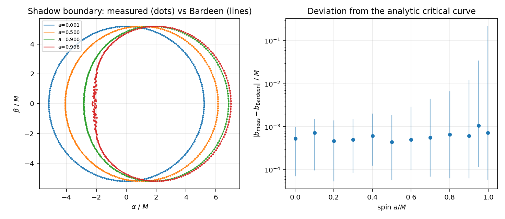
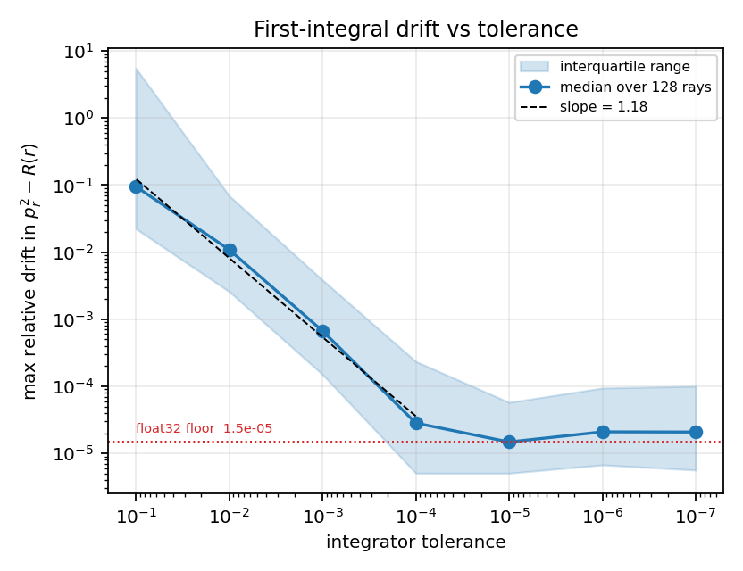
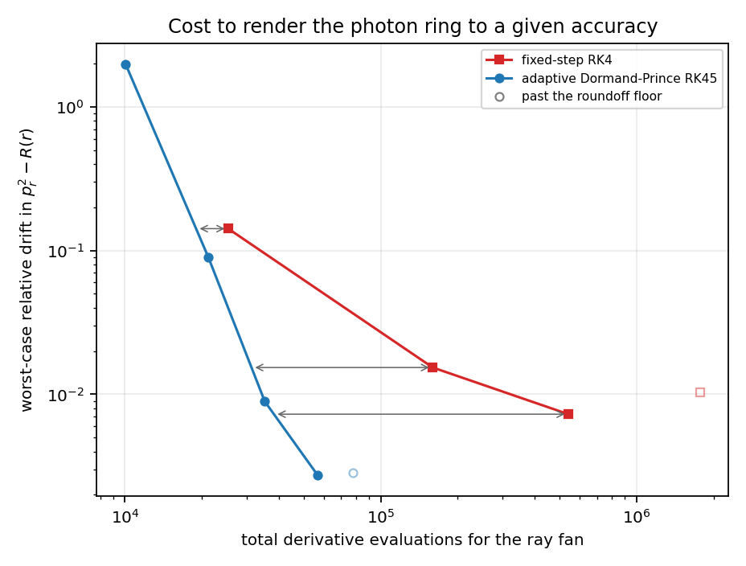
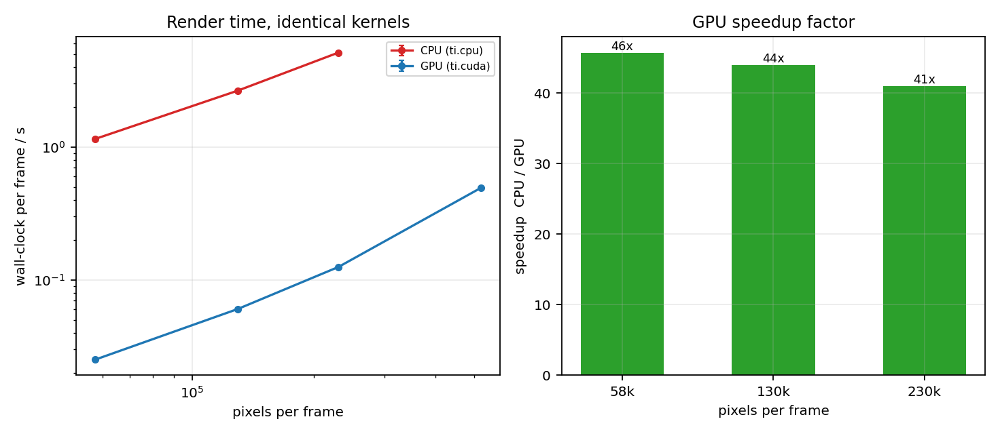
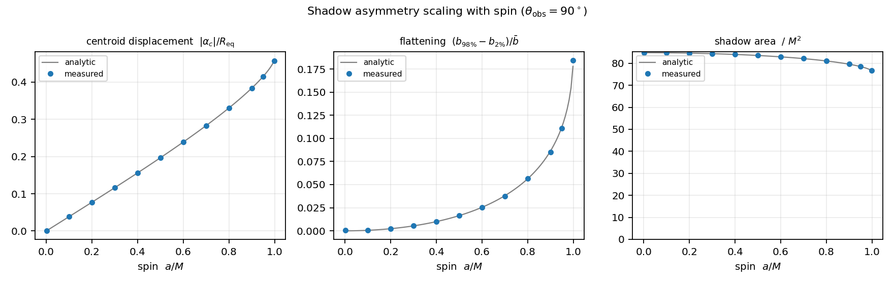
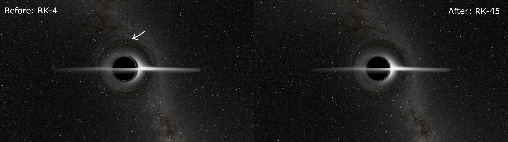
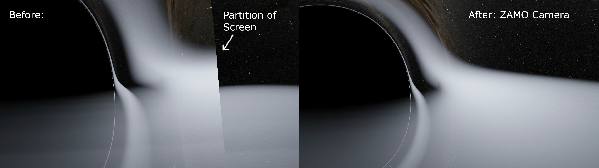

# Ray tracing a Kerr Black Hole

 black hole close up.png>)

▶ **[Full render on YouTube](https://www.youtube.com/watch?v=WAsO6kQBz_Y)** 

▶ **[Full write-up (CREST report)](docs/CREST_report.pdf)**

A GPU accelerated ray tracing program showing what a camera near a spinning (Kerr) black hole would see.

## Running the program

```bash
pip install -r ../requirements.txt
python kerr_raytracer.py
```

By default this renders a 1080p frame as 'render.png'. Adjustable settings are at the top of the file.

| Setting | Meaning |
|---|---|
| `a` | Controls Black hole spin, from 0 (not spinning) to just below 1 (maximal spin) |
| `MODE` | `"image"` generates one frame, `"video"` generates a sequence of frames along the camera path|
| `width, height` | Resolution (about 1.2 GB GPU memory at 1080p and 3.5 GB at 4K) |
| `VR_360` | Toggles 360° frames (requires a 2:1 resolution, e.g. 3840×1920) |
| `tol` | Integrator accuracy: `1e-6` is fast, `1e-8` is slower but removes fainter artefacts |

**Star map (optional):** For the background stars, download the 8K EXR from NASA SVS *Deep Star Maps 2020* and save it as 'assets/starmap_8k.exr'. Without it a default checkerboard pattern is used which clearly portrays the lensing effects.

**Video:** video frames are saved to '/frames', they can be stitched together into a single video with ffmpeg:

`ffmpeg -framerate 30 -i frames/frame_%04d.png -c:v libx264 -pix_fmt yuv420p output.mp4`

This code runs on NVIDIA GPUs via CUDA and falls back to Vulkan/Metal/CPU if unavailable (slower).

## The physics

Light near a black hole follows trajectories termed **null geodesics** which represent the straightest possible path within a curved spacetime. The spacetime near a spinning black hole is described by the Kerr metric. Each ray has 3 conserved quantities along its path: Energy $E$, Angular Momentum $L_z$ and the Carter Constant $Q$.
Using **Mino time** $\lambda$ (with $d\lambda = d\tau/\Sigma$ as an affine parameter, the radial and polar equations of motion separate into:

$$\frac{d^2r}{d\lambda^2} = \frac{1}{2}\frac{dR}{dr}, \qquad \frac{d^2\theta}{d\lambda^2} = \frac{1}{2}\frac{d\Theta}{d\theta}$$

where $R(r)$ and $\Theta(\theta)$ are the radial and polar potentials. Second order equations of motion are used as they automatically handle turning points without needing to change signs manually.

## How the code works

- **Camera:** For each pixel, 5 light rays are sent out in the direction of the camera (offset slightly for anti-aliasing).
- **Integration:** Each ray is numerically integrated with RK-45 adaptive step sizing until they strike the event horizon or escape to infinity.
- **Accretion disk:** A thin Novikov-Thorne accretion disk is used with vertical depth, and light rays accumulate intensity through the disk via Volumetric Integration.
- **Skybox:** A starmap (or checkerboard) is used as a spherical skybox. Rays escaping to infinity strike the skybox and the colour of light is sampled from it.
- **Display:** The light from each photon is compiled together to form an image (with anti-aliasing). Reinhard tone mapping and gamma correction are then applied as visual effects (not physical). A blue tint is also applied as an artistic touch, even though most light emitted from the accretion disk are x-rays.
- **GPU:** In the Taichi kernel, rays are processed in parallel by the GPU, independently from each other.


## Validation

| | |
|---|---|
|  | **Shadow shape** matches Bardeen's analytic critical curve, with median deviation around 10⁻³ for spins up to a = 0.95. |
|  | **Accuracy:** the error in a conserved quantity falls with integrator tolerance until it reaches the float32 limit (~1.5×10⁻⁵). |
|  | **Efficiency:** RK45 requires far fewer derivative evaluations than RK4 for the same accuracy. |
|  | **Speed:** the GPU version is significantly faster than the same kernel on the CPU. |

**Parameter study:** 

As spin increases, the shadow shifts sideways (linearly with spin) and flattens sharply above a ~ 0.8, but its area changes by only around 10%.

The results come from the CREST report. Code for the figures (original, not cleaned up and made for v16) available at docs/figures.


## Problems I solved

Full image gallery with captions: [progression/](progression/)

| Before / After | What happened |
|---|---|
|  | **Line of artefacts at the pole.** Fixed-step RK4 integrated previously jumped over the region near θ = 0 where the equations (in spherical Boyer-Lindquist coordinates) change rapidly. Many hacks I tried (v09) failed. This issue was finally resolved by switching to adaptive RK45 (v11) which mitigated numerical instability near the pole, fixed the artefacts and was also faster. |
|  | **Screen split into different views near the hole.** The rays assumed the camera is at rest relative to distant stars, which is impossible near a spinning black hole due to frame dragging, resulting in a partition when the camera came close to the event horizon. This was fixed by launching rays from a ZAMO (Zero Angular Momentum Observer) frame (v15) rather than at rest. | 


## Limitations

- The disk is a smooth thin-disk model, not a full GR magnetohydrodynamic (GRMHD) simulation. So, there is no turbulence, magnetic fields or jets and only primary emission.
- The Redshift effects change brightness but not colour of the disk.
- Only Prograde (orbiting along with black hole spin) accretion disks.
- 32-bit floating values are used to store values for speed, so precision is limited to ~10⁻⁵.
- Boyer–Lindquist coordinates break down at the horizon, so the camera can't go inside it (Cartesian Kerr-Schild coordinates would be required for that).


## References

Bardeen (1973); Bardeen, Press & Teukolsky (1972); Carroll (2004); Dormand & Prince (1980); Novikov & Thorne (1973); Page & Thorne (1974); James et al. (2015); Luminet (1979); Reinhard et al. (2002); Hu et al. (2019). Full bibliography in the [report](docs/CREST_report.pdf).

**Star map:** NASA/Goddard Space Flight Center Scientific Visualization Studio, *Deep Star Maps 2020*. Gaia DR2: ESA/Gaia/DPAC. Constellation figures based on those developed for the IAU by Alan MacRobert of Sky and Telescope (Roger Sinnott and Rick Fienberg).