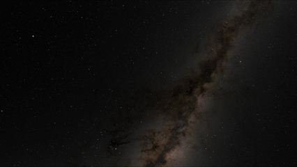

# Ray tracing an Alcubierre warp drive




▶ **[Full render with explanation for superluminal effects on YouTube](https://www.youtube.com/watch?v=uu0EVItuHY8)** 

A GPU accelerated ray tracing program showing what a stationary observer would see as a superluminal Alcubierre warp drive carrying a ship passes by.

## Running the program

```bash
pip install -r ../requirements.txt
python alcubierre_warp_drive.py
```

By default this renders one 1080p frame as `render.png`. Adjustable settings are at the top of the file.

| Setting | Meaning |
|---|---|
| `v_0` | Bubble speed in units of the speed of light (> 1 means faster than light) |
| `R`, `sigma` | Bubble radius and wall sharpness (wall thickness ~ 1/sigma) |
| `MODE` | `"image"` generates one frame, `"video"` generates frames over a time window |
| `width, height` | Resolution (about 1 GB GPU memory at 1080p and 2.8 GB at 4K) |
| `VR_360` | Toggles 360° frames (requires a 2:1 resolution, e.g. 3840×1920) |
| `init_t, final_t` | Start and end time of the video |

**Star map (optional):** for the background stars, download the 8K EXR from NASA SVS *Deep Star Maps 2020* and save it as `assets/starmap_8k.exr`. Without it, a default checkerboard pattern is used.

**Video:** video frames are saved to `frames/`; they can be stitched together into a single video with ffmpeg:

`ffmpeg -framerate 60 -i frames/frame_%04d.png -c:v libx264 -pix_fmt yuv420p output.mp4`

This code runs on NVIDIA GPUs via CUDA and falls back to Vulkan/Metal/CPU if unavailable (slower).


## The physics

The Alcubierre warp drive is described by the metric:

$$ds^2 = -dt^2 + \left(dx - v_s f(r_s)\, dt\right)^2 + dy^2 + dz^2$$

where $f(r_s)$ is around 1 inside the bubble and 0 outside, and $r_s$ is the distance from the bubble's centre. Space contracts in front of the bubble and expands behind it, which propagates the ship forward. Spacetime is locally flat inside the bubble and nothing inside moves faster than light locally, but the bubble as a whole can travel faster than light.

The equations of motion of light rays were derived by hand from the Euler–Lagrange equations. With $D = v_s f(r_s)$ and $p = \dot x - D\dot t$:

$$\ddot t = -p\,(D_x\, p + D_y\, \dot y + D_z\, \dot z)$$

$$\ddot x = -D_x\, \dot t\, p + \dot D\, \dot t + D\, \ddot t, \qquad \ddot y = -D_y\, \dot t\, p, \qquad \ddot z = -D_z\, \dot t\, p$$

where $D_x, D_y, D_z$ are partial derivatives of $D$ and $\dot D$ is its rate of change along the ray.
In this specific metric, it is necessary to integrate the time component of each geodesic (while unnecessary in the other 3 metrics) as this metric is **time-dependent** since the ship moves so intersections with the ship have to be calculated at the correct coordinate times.

**What you see:**
- Because the bubble is capable of outrunning its own light, the observer sees the ship's image appear spontaneously and split in two, with the images moving apart, similar to a sonic boom observed with supersonic aircraft.
- The ship's colour is determined by **when its light left the ship** (blue = earlier, red = later), thus one can see light from different moments reaching the observer at the same time.
- Dark purple regions are rays that can never get ahead of the bubble - the bubble's **horizon**.


Unfortunately again, a real warp drive would require exotic matter with negative energy density, which has not been observed in the real world. However, this simulation shows what one would look like if it could exist.


## How the code works

- **Camera:** placed at rest, outside the bubble where spacetime is flat. Rays are traced **backwards in time** from the camera to determine where the light came from.
- **Integration:** each ray is integrated with the same adaptive RK45 integrator as the Kerr ray tracer, with smaller steps near the ship so rays don't skip over it.
- **Ship:** each step is checked for crossing the ship's sphere (in the bubble's moving frame), so hits are detected exactly.
- **Skybox:** once a ray is ahead of the bubble wall, spacetime is flat from then on and its direction can no longer change, so the sky is sampled by the ray's **final direction** (a true sky at infinity).
- **Display:** the light from each photon is compiled together to form an image (with anti-aliasing). Reinhard tone mapping and gamma correction are then applied as visual effects (not physical).
- **GPU:** in the Taichi kernel, rays are processed in parallel by the GPU, independently from each other.


## Problems I solved

| Version | What happened |
|---|---|
| v01 -> v02 | **The bubble wasn't propagating while light travelled** The bubble stayed still for light rays propagating in every frame and only updated its position between frames. Since light takes time to reach the camera, the bubble's position must follow each ray's own time coordinate. |
| v01 -> v02 | **Rays traced the wrong way in time** Rays were integrated forward in time from the camera, however the process of ray tracing itself works backwards so rays should in practice be integrated backwards ($dt/d\lambda = -1$) to determine where the light came from. |
| v02 -> v03 | **Distorted sky** The sky was originally sampled by the ray's position on a sphere around the origin. This has been changed to sample the ray's direction instead once it is ahead of the bubble, enabling a more accurate mapping. |
| v02 -> v03 | **Ship appearing speckled** Large integration steps allowed rays to sometimes jump straight over the ship. This was fixed by capping the step size near the ship and testing each and every step for a crossing with the ship's sphere. |

Full version history: [versions/](versions/)

## Limitations

- The ship is only a coloured marker sphere and not a physical object.
- Changes in brightness and colour of light passing through the bubble are not modelled.
- Relativistic aberration has not been included in this model, preventing physically accurate perspectives from within the ship.
- The camera must stay outside the bubble where spacetime is flat.
- The escape test assumes the bubble stays faster than light.
- 32-bit floating values are used for speed, limiting precision to ~ 10⁻⁵.


## References

Alcubierre (1994); Clark, Hiscock & Larson (1999); Dormand & Prince (1980).

**Star map:** NASA/Goddard Space Flight Center Scientific Visualization Studio, *Deep Star Maps 2020*. Gaia DR2: ESA/Gaia/DPAC. Constellation figures based on those developed for the IAU by Alan MacRobert of Sky and Telescope (Roger Sinnott and Rick Fienberg).