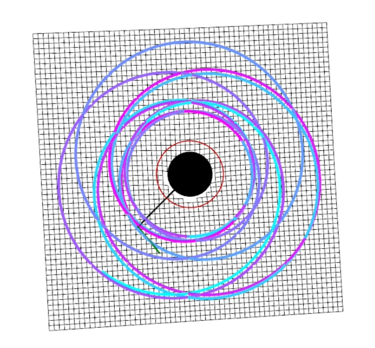
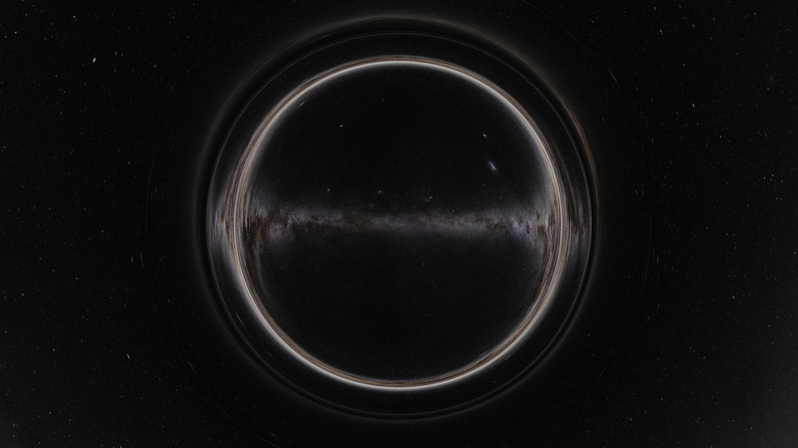

# Relativistic Simulations by Srikanth Mettu

This project contains four simulations of curved spacetime built from scratch in Python: an interactive simulator of orbits around a Schwarzschild black hole and three GPU-accelerated ray tracers showing what one would see near a spinning (Kerr) black hole, an Ellis wormhole and an Alcubierre warp drive.


▶ **[Kerr black hole render on YouTube](https://www.youtube.com/watch?v=WAsO6kQBz_Y)** 

▶ **[Full write-up (CREST report)](02-kerr-raytracer/docs/CREST_report.pdf)**


## Projects

| Project | What it does | Preview |
|---|---|---|
| [**Schwarzschild geodesics**](01-schwarzschild-geodesics) | Interactive simulator: launch light or particles around a black hole and watch their paths alongside a live Penrose diagram |  |
| [**Kerr black hole ray tracer**](02-kerr-raytracer) | GPU ray tracer of a spinning black hole with a glowing, volumetric accretion disk validated against analytic results · [video](https://www.youtube.com/watch?v=WAsO6kQBz_Y) |  black hole.png>) |
| [**Ellis wormhole**](03-ellis-wormhole) | A camera flying through a traversable wormhole into another universe · [video](https://www.youtube.com/watch?v=IK4DtV514to) |  |
| [**Alcubierre warp drive**](04-alcubierre-drive) | What a stationary observer sees as a faster-than-light warp bubble passes by ·[video](https://www.youtube.com/watch?v=uu0EVItuHY8) |  |

#

# Highlights

- **One engine for three spacetimes:** The Kerr, wormhole and warp drive ray tracer programs share the same adaptive Dormand–Prince (RK45) integrator and GPU pipeline. Only the equations of motion change and each set was derived by hand from the Lagrangian $\mathcal{L} = \tfrac{1}{2} g_{\mu\nu} \dot{x}^{\mu} \dot{x}^{\nu}$.
- **Validation:** The Kerr black hole's shadow matches Bardeen's analytic curve to ~10⁻³, and the integrator's error falls to the 32-bit floating-point limit.
- **Fast on a laptop:** Moving from plain Python to GPU code (Taichi) took a 4K frame being rendered from around 20 minutes to about a second on a GTX 1650 GPU.
- **Forged through problem-solving:** Each project's README has a "Problems I solved" section and every project's full version history is available in `versions/`.

## Running the code

Developed with Python 3.12

```bash
pip install -r requirements.txt
```

Then see each project's README for how to run it.

- Install `colour-science`, **not** `colour` (a different package with the same import name).
- The ray tracers run fastest on an NVIDIA GPU (CUDA), and fall back to Vulkan/Metal/CPU elsewhere.
- Sky images are optional downloads (see each project's README) for the background. Without them a checkerboard sky is used.
- Videos are stitched from frames with [FFmpeg](https://ffmpeg.org/) which must be installed seperately.

## Repository structure

```
relativistic-simulations/
├── 01-schwarzschild-geodesics/   interactive orbit simulator (PyVista)
├── 02-kerr-raytracer/            black hole ray tracer, validation figures, CREST report
├── 03-ellis-wormhole/            wormhole ray tracer
├── 04-alcubierre-drive/     warp drive ray tracer
└── requirements.txt
```

Each project folder contains the final program, a README, its images and a `versions/` folder with every archived version in order.

## About this project

The simulations were developed between April and June 2026 and organised into this repository in October 2026. The archived versions in each `versions/` folder are unmodified snapshots of that development. Changes made to the final files afterwards are listed in each `versions/README.md`.

I showed the simulations at my school's STEM club to explain gravity as curved spacetime, gravitational lensing and relativistic redshift.

**Tools and AI use:**
- [Perplexity](https://www.perplexity.ai/) helped me locate formulae in technical papers (the Doppler and gravitational redshift factors, later checked against the primary sources) and interpret Taichi runtime errors.
- In October 2026, [Claude](https://claude.ai/) reviewed my final code and found bugs (listed in each `versions/README.md`), wrote the restructured final versions of the Ellis and Alcubierre files based on my archived code, supplied code for later fixes and the Schwarzschild performance improvements, and helped draft these READMEs.
- I developed the physics derivations and equations of motion used in my implementations, drawing on the cited sources, and wrote the archived versions myself.

**Inspiration:** Alessandro Roussel's relativity simulations were used as a visual reference only. None of his code was read or used.

## Credits

- **Star map:** NASA/Goddard Space Flight Center Scientific Visualization Studio, *Deep Star Maps 2020*. Gaia DR2: ESA/Gaia/DPAC. Constellation figures based on those developed for the IAU by Alan MacRobert of Sky and Telescope (Roger Sinnott and Rick Fienberg).
- **Second star map:** ESO/S. Brunier, *The Milky Way panorama* ([eso0932a](https://www.eso.org/public/images/eso0932a/)), [CC BY 4.0](https://creativecommons.org/licenses/by/4.0/). Flipped and rotated in the renderer.
- **Libraries:** NumPy, Taichi, OpenCV, PyVista, VTK, colour-science, Matplotlib, Numba and FFmpeg, each under its own open-source licence.

## Licence

My code is released under the [MIT License](LICENSE). The sky images remain under their own licences above.